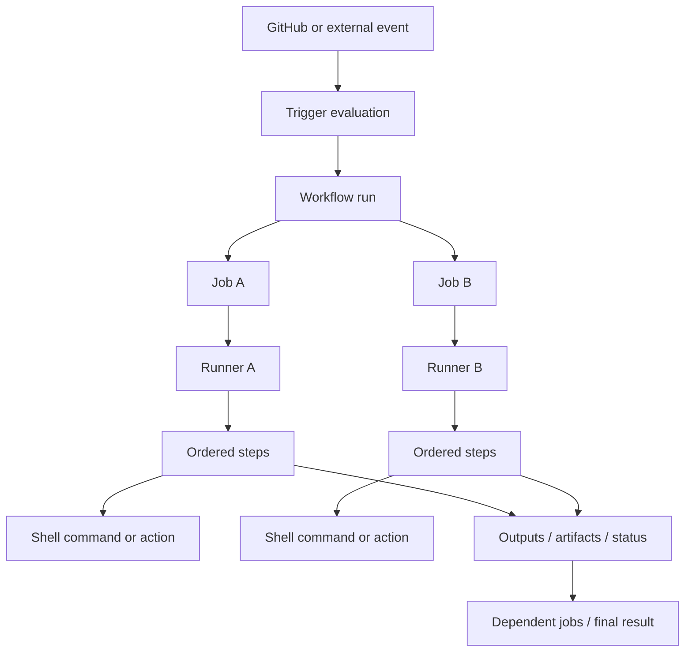

# GitHub Actions Core Components and Conceptual Architecture

## Summary

GitHub Actions can be understood as an event-driven workflow orchestration system. The public conceptual model consists of events, workflow definitions, workflow runs, jobs, steps, actions and runners. Supporting concepts include contexts, expressions, secrets, variables, artifacts, caches, environments and permissions.

The architecture below describes the documented user-facing model. It intentionally avoids claiming undocumented internal details of GitHub's proprietary hosted control plane.

## Component map

## Components and responsibilities

### 1. Event

An event is an activity or supported external signal that can trigger a workflow. Examples include:
- a commit pushed to a branch;
- a pull request opened or updated;
- a release published;
- an issue or issue comment event;
- a scheduled time;
- a manual workflow dispatch;
- a supported API dispatch.

The exact payload and activity types depend on the event. Branch/path filters and repository context can affect whether a run is created.

### 2. Workflow definition

A workflow is a YAML file stored in `.github/workflows/` with a `.yml` or `.yaml` extension. It declares:
- trigger configuration (`on`);
- workflow-level configuration;
- one or more jobs;
- optional permissions, environment variables, concurrency and defaults.

A repository can contain multiple workflows for distinct responsibilities, such as PR validation, nightly regression, release packaging and deployment.

### 3. Workflow run

A workflow run is a particular execution of a workflow definition in response to a trigger or manual invocation. It has a run identity, status/conclusion, event context, jobs and logs.

Do not confuse:
- workflow file: the version-controlled definition;
- workflow: the configured automated process;
- workflow run: one execution instance.

### 4. Job

A job is a set of steps executed on one runner. By default, jobs without dependencies can run in parallel. `needs` introduces dependencies and allows a directed job graph.

A job commonly defines:
- `runs-on`;
- `steps`;
- `needs`;
- `if`;
- `strategy` / `matrix`;
- `permissions`;
- `environment`;
- `timeout-minutes`;
- `concurrency`;
- container or service configuration where applicable.

Each job should be designed with explicit inputs and outputs rather than relying on another job's local filesystem.

### 5. Runner

A runner is the execution environment that runs a job. GitHub-hosted runners are provisioned by GitHub. Self-hosted runners are machines operated by the repository owner, organization or enterprise.

A job is routed according to its `runs-on` requirements and runner availability. Runner labels and groups are important for self-hosted routing.

### 6. Step

A step is an individual task within a job. It can:
- run a shell command using `run`;
- invoke an action using `uses`.

Steps in a job execute in sequence by default and share the job's runner workspace. Each `run` step executes in its own process, so shell-process environment changes do not automatically persist into later steps. Use supported environment files, outputs or other explicit mechanisms to pass values.

### 7. Action

An action is a reusable unit of automation invoked as a step. Actions may be authored by GitHub, third parties or your organization. Common tasks include checking out code, configuring a language toolchain, caching dependencies and uploading artifacts.

An action is not the same thing as a workflow. A workflow orchestrates jobs; an action performs a reusable task inside a step.

### 8. Contexts and expressions

Contexts expose runtime information such as repository, event, runner, job, step, inputs, variables and secrets. Expressions allow dynamic evaluation in supported workflow fields.

Context availability and expression evaluation timing vary by workflow key. Consult the current contexts reference before using a context in a particular field.

### 9. Artifacts and caches

Artifacts preserve files produced by a workflow run and can transfer files between jobs or make outputs available for later download. Caches accelerate repeated dependency or build work. They have different purposes and security/access semantics; do not treat them as interchangeable.

### 10. Environments, variables, secrets and permissions

These features govern deployment targets, configuration values, sensitive values and token capabilities. Use least privilege and environment protection where appropriate. Secrets are not a substitute for safe handling of untrusted input.

## Responsibility boundaries

| Concern | Main component |
|---|---|
| What starts automation? | Event and trigger configuration |
| What is the automation definition? | Workflow YAML |
| Which tasks belong together? | Job |
| Where does the job execute? | Runner |
| What individual operation runs? | Step |
| What reusable task is invoked? | Action |
| How are jobs ordered? | `needs` dependency graph |
| How is runtime data referenced? | Contexts and expressions |
| How are files passed or retained? | Artifacts / explicit storage |
| What can the workflow token access? | Permissions and token scopes |

## Architecture design guidance for test engineering

A maintainable test pipeline often separates:
1. source checkout and dependency preparation;
2. build;
3. fast unit tests;
4. API/contract tests;
5. UI or end-to-end tests;
6. report and artifact publication;
7. deployment or promotion, if authorized.

Choose job boundaries based on isolation, parallelism, required tools, security boundaries and artifact transfer cost. Avoid splitting every small command into a separate job: jobs introduce scheduling and data-transfer boundaries.

## Failure boundaries

When a workflow fails, locate the boundary before changing YAML:
- trigger not created: inspect event, filters, default-branch rules, workflow enabled state and skip conditions;
- run created but job queued: inspect runner labels, groups, availability and policy;
- job starts but step fails: inspect shell, environment, permissions, network and action behavior;
- job succeeds but downstream job does not: inspect `needs`, outputs and `if` conditions;
- deployment step fails: inspect target credentials, identity, IAM/RBAC and network path.

## Related documents

- GHA-FUND-001 — What Is GitHub Actions?
- GHA-ARCH-002 — Workflow Run and Job Execution Lifecycle
- GHA-RUN-001 — Runner Types and Job Routing
- GHA-REF-001 — Minimal Workflow Syntax Reference

## Sources

- SRC-GHA-UNDERSTAND
- SRC-GHA-CONCEPTS
- SRC-GHA-WORKFLOW-SYNTAX
